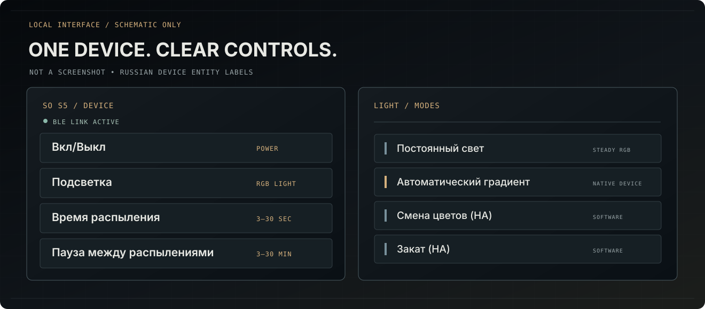

<a href="README.md">English</a> &nbsp;·&nbsp; <a href="README_RU.md">Русский</a> &nbsp;·&nbsp; <a href="README_DE.md">Deutsch</a> &nbsp;·&nbsp; <a href="README_FR.md">Français</a> &nbsp;·&nbsp; <a href="README_ES.md">Español</a> &nbsp;·&nbsp; <a href="README_ZH_CN.md">中文</a>

  
  
  

# Xiaomi SO Diffuser BLE

**Local Bluetooth control of SO / BWJ aroma diffusers for Home Assistant.**

> **SO S5** has user-reported working controls and native color cycling. Other SO models remain **experimental**, not certified.

| | |
| --- | --- |
| ⏻ | **On/Off** — spray operation |
| 〰 | **Spray** — duration, pause, zero-pause option |
| ◉ | **Backlight** — RGB, native gradient and optional HA color palettes |
| ↗ | **Xiaomi sign-in** — one-time device token; local BLE afterwards |

## Quick start

1. Install this repository from **HACS / Marketplace** as an **Integration**.
2. Add **Xiaomi SO Diffuser BLE** in Home Assistant. Turn the diffuser on, then select the device.
3. Sign in via Xiaomi and select the exact diffuser. Confirm any experimental-model warning.
4. Test the physical **On/Off** switch before creating automations.

If Xiaomi redirects to an unreachable `homeassistant.local`, replace only the **host of the final browser callback URL** with the address of your HA server. Leave the webhook path and authorization parameters unchanged. Do not publish that callback.

*Illustrative interface, not a live Home Assistant screenshot.*

## Model compatibility

- **S5 — real-device results reported**
- **S1, S1 Pro, S2, S6, S7, S8, S9, S19 — experimental BLE profiles**

Lighting: **Steady**, **Automatic Gradient** (native), **Color Cycle (HA)** and **Sunset (HA)**. The HA effects require an active connection.

## Documentation

[Installation](docs/INSTALLATION.md) · [Model matrix](docs/COMPATIBILITY.md) · [Architecture](docs/MULTI_MODEL_ARCHITECTURE.md) · [Release notes](docs/RELEASE_NOTES.md) · [Roadmap](ROADMAP.md)

---

*An independent community integration. Not affiliated with Xiaomi or the Home Assistant project.*
