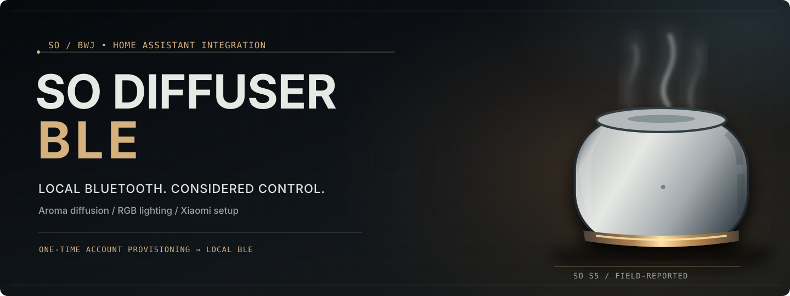
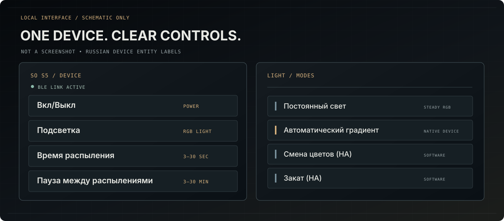

<a href="README.md">English</a> &nbsp;·&nbsp; <a href="README_RU.md">Русский</a> &nbsp;·&nbsp; <a href="README_DE.md">Deutsch</a> &nbsp;·&nbsp; <a href="README_FR.md">Français</a> &nbsp;·&nbsp; <a href="README_ES.md">Español</a> &nbsp;·&nbsp; <a href="README_ZH_CN.md">中文</a>

  
  
  

# Xiaomi SO Diffuser BLE

**Contrôle Bluetooth local des diffuseurs SO / BWJ dans Home Assistant.**

> **SO S5** a été testé sur un appareil réel. Les autres modèles restent **expérimentaux**.

| | |
| --- | --- |
| ⏻ | **Marche/arrêt** — commande de la diffusion |
| 〰 | **Diffusion** — durée, pause et mode sans pause |
| ◉ | **Éclairage** — RGB, dégradé intégré et effets HA |
| ↗ | **Connexion Xiaomi** — jeton initial, puis Bluetooth local |

## Démarrage rapide

1. Installez ce dépôt via **HACS / Marketplace** comme **Intégration**.
2. Ajoutez **Xiaomi SO Diffuser BLE** dans Home Assistant, allumez le diffuseur et sélectionnez-le.
3. Connectez-vous à Xiaomi et choisissez le bon appareil. Confirmez l'avertissement expérimental si nécessaire.
4. Vérifiez physiquement la marche et l'arrêt avant toute automatisation.

Si Xiaomi renvoie vers une adresse `homeassistant.local` inaccessible, remplacez **uniquement l'adresse du serveur dans l'URL finale du navigateur**. Conservez le chemin du webhook et ses paramètres; ne partagez pas ce lien.

*Schéma de l'interface, pas une capture d'écran d'une installation réelle.*

## Compatibilité des modèles

- **S5 — essai réel confirmé par l'utilisateur**
- **S1, S1 Pro, S2, S6, S7, S8, S9, S19 — profils BLE expérimentaux**

Éclairage : **Lumière fixe**, **Dégradé automatique** (natif), **Cycle des couleurs (HA)** et **Coucher de soleil (HA)**. Les effets HA nécessitent une connexion active.

## Documentation

[Installation (anglais)](docs/INSTALLATION.md) · [Compatibilité (anglais)](docs/COMPATIBILITY.md) · [Architecture (anglais)](docs/MULTI_MODEL_ARCHITECTURE.md) · [Notes de version (anglais)](docs/RELEASE_NOTES.md)

---

[MIT](LICENSE)

*Projet communautaire indépendant, sans affiliation à Xiaomi ni Home Assistant.*
