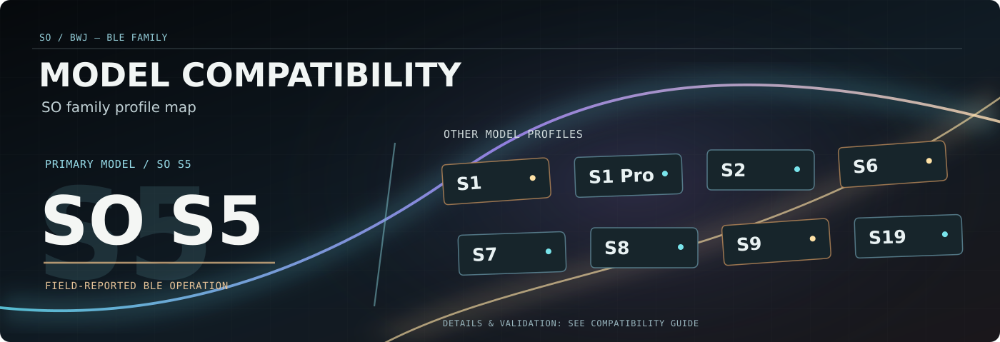

# SO / BWJ diffuser compatibility

Published Xiaomi **MIoT property descriptions** can suggest which entities to create, but cannot establish the correct Bluetooth transport or guarantee that a command actually controls a physical device.

| SO model | Xiaomi model | Power / spray | RGB | Other | BLE status |
| --- | --- | --- | --- | --- | --- |
| **S5** | `bwj.diffuser.s5` | Yes | Yes | Zero-pause / LongSpray | **Field-reported working (earlier build)** |
| S2 | `bwj.diffuser.h10` | Spec matches | Yes | — | Experimental |
| S6 | `bwj.diffuser.s6` | Spec matches | Yes | — | Experimental |
| S7 | `bwj.diffuser.bw11` | Spec matches | Yes | — | Experimental |
| S8 | `bwj.diffuser.s8` | Spec matches | Yes | — | Experimental |
| S9 | `bwj.diffuser.s9` | Spec matches | Yes | — | Experimental |
| S1 Pro | `bwj.diffuser.s1pro` | Spec matches | Yes | Read-only temperature, if notified | Experimental |
| S1 | `bwj.diffuser.k09` | Spec matches | **No** | — | Experimental |
| S19 | `bwj.diffuser.s19` | Spec matches | **No** | — | Experimental |

**Experimental profiles in 1.0.0:** All nine published SO models provide the bounded MIoT idle-time property `3.4` with special value `0`. Non-S5 models now expose a clearly labeled **zero-pause experiment**, not a promise of physically uninterrupted spraying. Other features remain based on their published capabilities: spray time, ordinary pause, battery/charging, RGB/gradient for RGB models and optional S1 Pro temperature. A **BLE connection** diagnostic reports disconnected/connected even while other entities are unavailable. Native timer and repeat-register writes remain disabled.

Only exact registered Bluetooth names can trigger automatic discovery. A missing name is **not proof that the device is unsupported**; enter its MAC manually if you know it. Never match all devices with Xiaomi FE95 service data.

The setup wizard obtains an **exact Xiaomi account model ID**, verifies its 12-byte GATT token against the chosen **physical BLE address**, and requires a second explicit consent step for non-S5 models. A real, valid GATT login is **necessary but not sufficient** to certify the correctness of the individual property writes. Do not create unattended automations until physical power switching works.

## What is not covered

- Generic Xiaomi scent diffusers with an unknown MIoT model ID.
- Xiaomi BLE Mesh products, unrelated Wifi/miIO appliances, and different authentication families (for example security-chip ECDH variants).
- Native device timer/schedule registers: use HA automations until the firmware fields have been reverse-engineered and verified.

## How to confirm a new model

1. Check its exact Xiaomi model and Bluetooth advertisement from the real device.
2. Confirm Xiaomi OAuth returns an appropriate 12-byte **device** GATT token, not `BLE_DATA.beaconkey`.
3. Complete real cryptographic Standard Auth; if it fails, investigate transport rather than trying arbitrary property writes.
4. Confirm the returned power state; operate ON and OFF while observing the diffuser.
5. Independently verify spray timing and lighting only where supported.
6. Repeat after HA restart and with WAN disconnected. Record firmware and **redacted** evidence.

**Never publish OAuth code/state, GATT tokens, MAC addresses or raw captures.**

## Sources and deeper analysis

- [Xiaomi MIoT spec: S5](https://home.miot-spec.com/spec/bwj.diffuser.s5), [S6](https://home.miot-spec.com/spec/bwj.diffuser.s6), [S2](https://home.miot-spec.com/spec/bwj.diffuser.h10), [S7](https://home.miot-spec.com/spec/bwj.diffuser.bw11), [S8](https://home.miot-spec.com/spec/bwj.diffuser.s8), [S9](https://home.miot-spec.com/spec/bwj.diffuser.s9), [S1 Pro](https://home.miot-spec.com/spec/bwj.diffuser.s1pro), [S1](https://home.miot-spec.com/spec/bwj.diffuser.k09), [S19](https://home.miot-spec.com/spec/bwj.diffuser.s19)
- [Multi-model protocol architecture and analogous projects](MULTI_MODEL_ARCHITECTURE.md)
- [S5 spray-mode research](SPRAY_MODES_AND_COMPATIBILITY.md)
