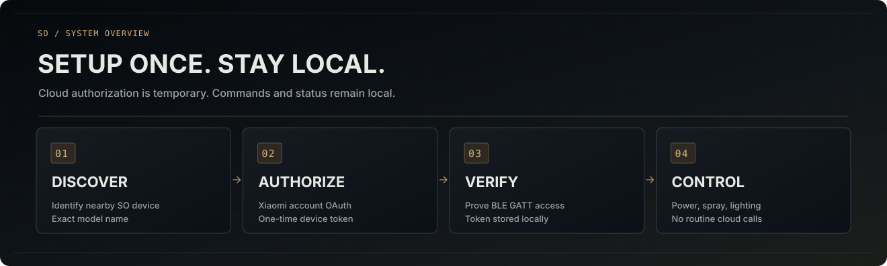
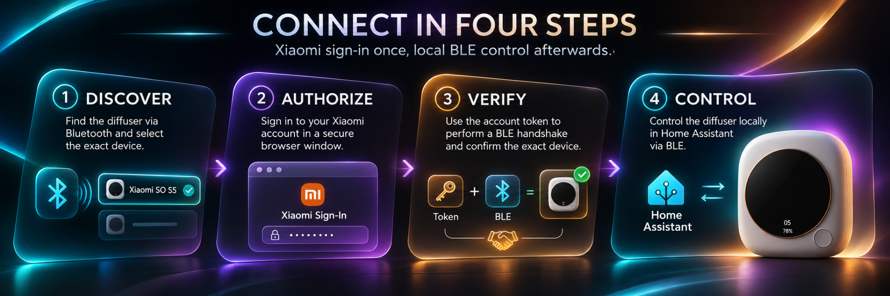

# Installation

**Current package/domain:** `custom_components/so_diffuser_ble` · `so_diffuser_ble` · v1.0.7 release candidate (interactive discovery and per-device token storage; S5 short-session behavior reported working; long-idle recovery not field-certified).  
## Install

1. Open **Settings → Marketplace** (formerly **HACS**), search for **Xiaomi SO Diffuser BLE** in the community integration catalog, and install it.
2. Confirm that `/config/custom_components/so_diffuser_ble/manifest.json` exists and declares `"domain": "so_diffuser_ble"`. There must be **no second installed SO integration for the same physical device**.
3. **Restart Home Assistant**.
4. Open **Settings → Devices & services → Add integration → Xiaomi SO Diffuser BLE**.
5. On the device picker, choose **Search nearby devices (10 seconds)** to listen for fresh connectable Bluetooth advertisements using Home Assistant's existing adapter/ESPHome Bluetooth proxy. Select your physical SO/BWJ diffuser from the results, or search again. Unknown devices are labelled **unverified**. If none appear, choose **Enter Bluetooth address manually**. Then select the Xiaomi account region and **Sign in with Xiaomi**.
6. Sign in on Xiaomi's website and choose the *same physical device* from the cloud list. All non-S5 models require explicit experimental confirmation.
7. The wizard uses the selected **device GATT token** to authenticate against the actual BLE device. A token is saved only after this proof. Confirm physical on/off before using automations.

The SO S5 has user-reported working controls on the current Home Assistant canary and a brief BLE disconnection/reconnection. **Recovery after 8–24 hours of standby and every non-S5 model remain physically unverified.**

## Common questions

### I can see my diffuser in Xiaomi, but it does not connect

The account listing proves only device registration. Other SO models may use a different GATT authentication flow despite sharing MIoT property numbers. Do not substitute a different device's token or generic MiBeacon key. See [compatibility](COMPATIBILITY.md).

### The device is not automatically offered

Initially the device picker lists only exact, known SO Bluetooth advertisement names. Choose **Search nearby devices (10 seconds)** to see new advertisements and other connectable Bluetooth devices, including unnamed or unrecognized devices labelled **unverified**. This uses Home Assistant's existing scanner rather than starting a competing Bluetooth scan; it cannot detect a sleeping device or work without an active, connectable adapter or proxy. Try again closer to the adapter/proxy, then select the correct physical device or use **Enter Bluetooth address manually**. The Xiaomi Cloud model selection and live BLE GATT proof remain mandatory before any token is stored.

### Xiaomi returns me to an inaccessible homeassistant.local address

**After logging in at account.xiaomi.com**, if the browser cannot resolve `http://homeassistant.local:8123/`, replace **only that base URL in the final browser address bar** with your HA address, for example `http://192.168.1.50:8123/`. If HA uses a custom port, use that port. Keep `/api/webhook/...` and OAuth `code`/`state` unchanged, then press Enter. This workaround was user-reported working with the previous build. **Do not change the `redirect_uri` in the original Xiaomi authorization request**. The separate manual pasted-URL flow is available but not yet hardware accepted.

Never share the full callback URL or its one-time authorization code.

### Can I reuse a saved token?

Only a token already saved for **this exact Bluetooth address** in the new `/config/.storage/so_diffuser_ble_tokens.json` store. Legacy S5 token files are not read. A diffuser that previously depended on them needs a new Xiaomi sign-in to provision its device-specific token. See [credentials](CREDENTIALS.md) and the [breaking-change instructions](MIGRATION.md). Xiaomi account passwords and OAuth refresh tokens are not stored.

### Does it need Xiaomi Cloud every day?

No for normal BLE commands: cloud access is used during optional onboarding and reconfiguration, and the device-specific token is loaded from private HA storage. Restart/reconnection with WAN disabled remains a release acceptance test.

## After installation

- **On/Off:** controls scent diffusion with MIoT property `2.1004`, independent of LED lighting. The default Russian label sorts above the Backlight entity in HA's device-page control list; user-renamed entities may sort differently.
- Spray duration: 3–30 s; ordinary pause: 3–30 min.
- **Zero-pause mode:** the S5 continuous-mode switch and its experimental equivalent on other SO models both write `3.4 = 0`. Physical spray cadence must be measured separately.
- **Backlight:** steady color, the device's native **Automatic Gradient** (`3.8 = 238`), plus two optional HA-driven color palettes (**Color Cycle** and **Sunset**) changing RGB through the already allowed `3.9` property at most once every 8 seconds. Software palettes stop when the backlight is switched off, BLE disconnects or the entity is unloaded, whereas the native gradient continues without HA. Only on RGB-capable models; **not on S1/S19**.
- Battery/charging readings when received; S1 Pro temperature when reported.
- **BLE connection:** read-only connectivity diagnostic that remains visible while disconnected.
- Schedule the diffuser through standard Home Assistant automations. Native timer registers remain intentionally unsupported.

## Troubleshooting and safety

If Bluetooth is unavailable, verify a **connectable** local Bluetooth adapter or ESPHome Bluetooth proxy. A passive-only scanner cannot make authenticated GATT connections. Turn on the diffuser, close Mi Home on the phone and temporarily disable its Bluetooth if it is holding the exclusive BLE link. Only one HA config entry/domain should control a physical diffuser.

Do not reset/unbind a device as a first troubleshooting step. Do not post MAC addresses, GATT tokens, private captures or OAuth redirects to public issues.

More: [README](../README.md) · [Russian README](../README_RU.md) · [Supported models](COMPATIBILITY.md) · [Documentation index](README.md).
