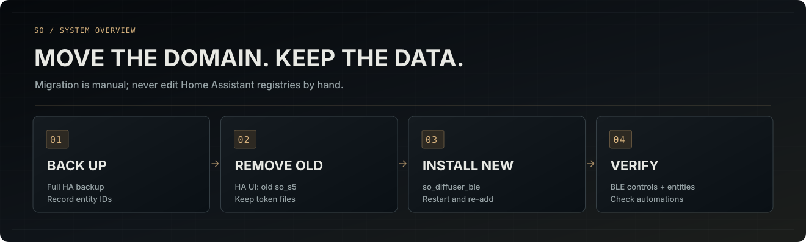

# Moving from `so_s5` to `so_diffuser_ble`

**Applies to public release 1.0.0 and later.** This is a **breaking integration-domain rename**, not a cosmetic label change. The former `so_s5` configuration entry will **not** automatically become `so_diffuser_ble`; Home Assistant does not provide a public integration API for changing an existing entry's domain. This repository continues to ship **one** HACS-managed integration.

## Why

The former domain was tied to one model even though the source now contains a registry of SO S1, S1 Pro, S2, S5, S6, S7, S8, S9, S19. The public name stays **Xiaomi SO Diffuser BLE**, repository slug stays `xiaomi-so-diffuser-ble`, new package and manifest domain are `so_diffuser_ble`.

## For an existing working S5

1. **Create a full Home Assistant backup first** (Settings → System → Backups). Record your current entity IDs and the automations that use them. Do not export your token to chat, GitHub or public logs.
2. **Do not erase the credential files.** The new integration retains read access to the existing private `/config/.storage/so_s5_ble_tokens.json` store, keyed by Bluetooth address, plus the old `/config/so_s5_token` fallback. They are implementation/credential history, *not* the new domain.
3. In **Settings → Devices & services**, open the old **Xiaomi SO Diffuser BLE** entry under `so_s5` and remove it through **Home Assistant's UI**. This is expected to remove its associated HA device/entity registrations. **It may affect automations referencing those entities**; record their entity IDs before removal.
4. In HACS, update/reinstall the custom repo. Confirm there is exactly **one** integration directory: `/config/custom_components/so_diffuser_ble/manifest.json`. If the earlier `/config/custom_components/so_s5` code was left behind, remove **only that old code folder** after removing its config entry. **Never edit `core.config_entries` or the entity registry JSON by hand.**
5. **Restart HA.** Add **Xiaomi SO Diffuser BLE** under the new domain. Select S5 and choose **Use previously saved S5 token** if its credentials still exist, or **Sign in with Xiaomi** to acquire a new token. Complete the wizard.
6. Confirm the power switch and other entities, restore any changed entity IDs in HA UI, and verify automations. A matching BLE address and entity unique-ID *suffix* are not guarantees that Home Assistant will preserve old registry IDs across an integration-domain change.
7. Restart HA again and verify local controls and authentication without Xiaomi Cloud. Only consider retiring obsolete credential files after a verified, backed-up migration; this code does **not** delete either token automatically.

**Never run both `so_s5` and `so_diffuser_ble` against the same physical device.** The new setup wizard checks for a registered legacy `so_s5` entry with the same address and refuses a duplicate. The old folder is not shipped in this HACS repository because HACS supports one integration per repository.

## Fresh installations

Install `so_diffuser_ble` from this repository, restart HA, select a discoverable SO candidate or enter a Bluetooth address, then use Xiaomi OAuth to select the exact cloud model. **Only S5 is field-confirmed**; the eight other SO profiles require separate experimental consent and a BLE GATT login proof.

## Why the secret file still has `so_s5` in its name

This is intentional backward compatibility: renaming the public integration domain should **not** silently discard or rewrite valid per-device BLE credentials. The secret remains private to Home Assistant and must not be added to backups distributed publicly, tickets or repository files. The storage filename can be transitioned independently after live migration is verified.

## Verification checklist

- `custom_components/so_diffuser_ble/manifest.json` contains `"domain": "so_diffuser_ble"`.
- `custom_components/so_s5` is absent **after** old entry removal.
- Home Assistant has only one config entry for a particular physical BLE address across old and new domains.
- Token is present and owner-only readable (inspect **existence and permissions**, never dump bytes).
- At least one physical OFF/ON command works; no phantom RGB on S1/S19.
- Reconnection and automations work after HA restart; WAN-off check is still recommended.

See [installation](INSTALLATION.md), [model compatibility](COMPATIBILITY.md) and [technical architecture](MULTI_MODEL_ARCHITECTURE.md).
