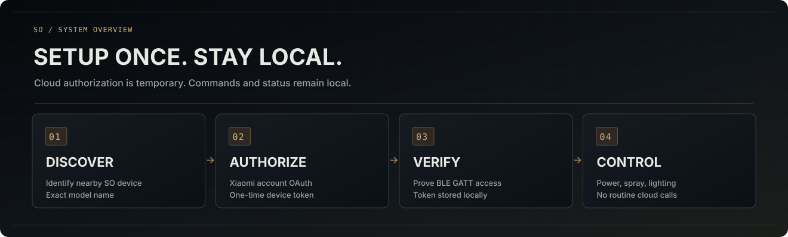

# Установка и подключение

[Русская документация](README.md) · [Модели](COMPATIBILITY.md) · [Миграция](MIGRATION.md)

Интеграция Xiaomi SO Diffuser BLE подключает аромадиффузоры SO/BWJ к Home Assistant через Bluetooth. Xiaomi Cloud используется для первоначального получения **токена конкретного устройства**, но не для повседневных команд.

## Новая установка

1. Открой **Настройки → Marketplace** (ранее **HACS**), найди **Xiaomi SO Diffuser BLE** и установи интеграцию из каталога.
2. Проверьте наличие файла `/config/custom_components/so_diffuser_ble/manifest.json`. Его поле `domain` должно быть равно `so_diffuser_ble`.
3. Перезапустите Home Assistant. Перейдите в **Настройки → Устройства и службы → Добавить интеграцию → Xiaomi SO Diffuser BLE**.
4. В мастере выберите **«Искать устройства (10 секунд)»**. Home Assistant соберёт новые Bluetooth-объявления через свой адаптер или Bluetooth-прокси и покажет найденные устройства. Выберите свой SO/BWJ; незнакомые устройства будут отмечены как **«не подтверждено»**. Поиск можно повторить. Если ничего нет, выберите **«Ввести Bluetooth-адрес вручную»**. Укажите регион аккаунта Xiaomi.
5. Откройте предложенную страницу Xiaomi, авторизуйтесь и выберите **то же физическое устройство** из списка аккаунта.
6. Если модель отличается от S5, подтвердите предупреждение об экспериментальной совместимости. Интеграция проверит токен по Bluetooth перед сохранением.
7. Проверьте физическое включение и выключение диффузора. Только затем создавайте автоматизации.

В v1.0.7 мастер поиска мог ожидать объявления, не запрашивая активный поиск в режиме Bluetooth **Auto**. Исправление запрашивает у Home Assistant отдельное 10-секундное окно активного сканирования. Это не заменяет диагностику неисправного драйвера/USB/BlueZ на хосте.

**Важно:** наличие прибора в Xiaomi Cloud не доказывает, что он поддерживает защищённый GATT-протокол S5. Другие модели остаются экспериментальными.

## Если Home Assistant не открывается после входа Xiaomi

**После авторизации на account.xiaomi.com**, если браузер не может открыть `http://homeassistant.local:8123/`, замените **только начало конечного адреса в строке браузера** на адрес своего Home Assistant, например `http://192.168.1.50:8123/`. Если у вашего HA другой порт, используйте его. Путь `/api/webhook/…` и параметры `code`/`state` должны остаться неизменными. Нажмите Enter.

Не редактируйте параметр `redirect_uri` внутри исходной ссылки авторизации Xiaomi. Никому не отправляйте конечный адрес с одноразовым кодом.

## Если устройство не обнаружено

До запуска поиска мастер показывает устройства с **точными известными Bluetooth-именами** SO. Нажмите **«Искать устройства (10 секунд)»**, чтобы дождаться новых объявлений BLE и показать другие доступные для подключения Bluetooth-устройства, в том числе без имени. Они будут помечены как непроверенные. Поиск использует существующий сканер Home Assistant, **не запускает второй сканер** и не обнаружит выключенный прибор или недоступный Bluetooth-прокси. Включите диффузор, приблизьте к активному адаптеру/прокси, закройте Mi Home и при необходимости отключите Bluetooth телефона. При отсутствии устройства остаётся ручной адрес. Совместимость подтверждается только выбором модели в Xiaomi Cloud и успешной проверкой токена по GATT.

## Доступные функции

- **Вкл/Выкл:** включение и выключение распыления. Имя подобрано так, чтобы в стандартном списке управления переключатель стоял перед «Подсветкой». Пользовательские названия сущностей могут изменять сортировку.
- **Длительность и пауза распыления:** обычные настройки устройства.
- **Нулевая пауза:** режим `3.4 = 0`. На S5 известен как непрерывное распыление; на других моделях предлагается с предупреждением об экспериментальности. Фактический цикл двигателя не измерен.
- **Подсветка и цвет:** **«Постоянный свет»**, аппаратный **«Автоматический градиент»**, а также программные **«Смена цветов (HA)»** и **«Закат (HA)»**. Два последних эффекта меняют цвет через существующую RGB-команду не чаще одного раза в 8 секунд; необходима работающая BLE-связь и Home Assistant. После выключения подсветки, потери связи или выгрузки интеграции цикл прекращается.
- **Батарея, зарядка и состояние BLE:** диагностические сведения, если устройство их передаёт. На S1 Pro также предусмотрена температура, если приходит уведомление.
- **Расписание:** используйте штатные автоматизации Home Assistant; непроверенные регистры расписания самого диффузора не записываются.

## Существующая установка

Новые токены сохраняются только в `/config/.storage/so_diffuser_ble_tokens.json` отдельно для каждого BLE-адреса. Старые файлы S5 больше не читаются: понадобится заново войти в Xiaomi для каждого диффузора. Не редактируйте реестры Home Assistant вручную. См. [инструкцию перехода](MIGRATION.md).

Для новой установки на прежнем домене, без актуальной записи устройства, обычной последовательности выше достаточно. Повторное подключение после перезапуска и работа без интернета для текущего исходного кода ещё требуют аппаратной проверки. Опубликованный тег `v1.0.0` может отличаться от состояния ветки `main`.
