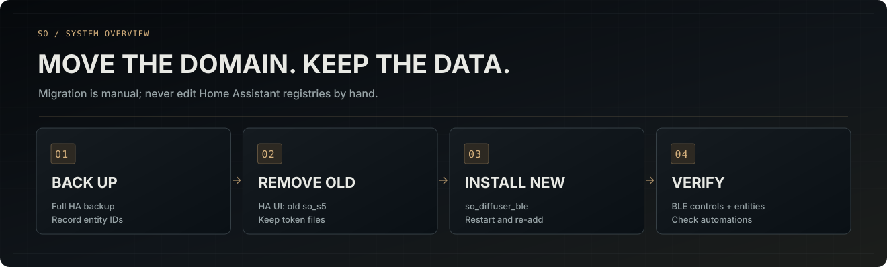

# Переход с `so_s5` на `so_diffuser_ble`

[Русская документация](README.md) · [Установка](INSTALLATION.md)

**Внимание:** смена домена интеграции Home Assistant — не обычное переименование. Старая запись `so_s5` не превращается автоматически в `so_diffuser_ble`. При повторном добавлении могут измениться идентификаторы сущностей и ссылки в автоматизациях.

1. Создайте полную резервную копию Home Assistant. Запишите текущие идентификаторы сущностей и автоматизации, которые на них ссылаются.
2. Сохраните существующие приватные BLE-токены. Новая интеграция умеет читать прежнее хранилище; **не удаляйте токены** и не отправляйте их в GitHub или чат.
3. Откройте **Настройки → Устройства и службы**, найдите старую интеграцию SO под доменом `so_s5` и удалите **её запись через интерфейс HA**. Не редактируйте `core.config_entries` или реестр сущностей вручную.
4. Установите новую интеграцию, у которой единственный каталог — `custom_components/so_diffuser_ble`. При необходимости удалите оставшуюся **старую папку кода** `custom_components/so_s5`, но только после удаления её записи. Не трогайте секреты.
5. Перезапустите Home Assistant. Добавьте Xiaomi SO Diffuser BLE и выберите свой S5. Используйте сохранённый токен, если он доступен, либо пройдите вход Xiaomi заново.
6. Проверьте созданные сущности и восстановите прежние идентификаторы через интерфейс HA, если это необходимо для автоматизаций. Проверьте физическое управление.
7. Перезапустите HA ещё раз и убедитесь, что локальное подключение работает без повторной авторизации. Отдельно проверьте работу без доступа к Xiaomi Cloud.

**Не запускайте одновременно две интеграции для одного BLE-адреса.** Новый мастер предотвращает подключение, если видит старую запись `so_s5` с таким адресом.

Названия ранее сохранённых файлов токенов намеренно не менялись: совместимость секретов с новой версией важнее косметического переименования. Содержимое приватных файлов не нужно выводить в терминал или публиковать.

Подробное описание поведения Home Assistant см. в [англоязычной технической инструкции](../MIGRATION.md).
